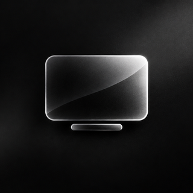
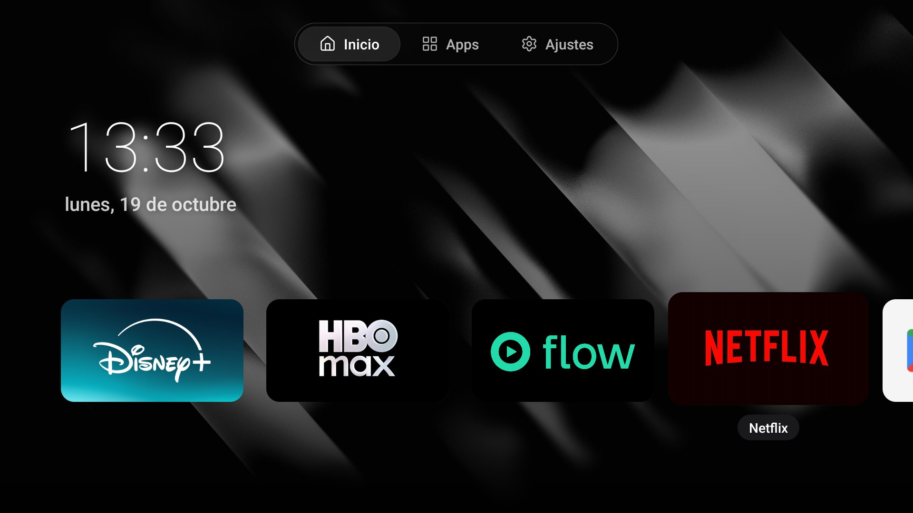
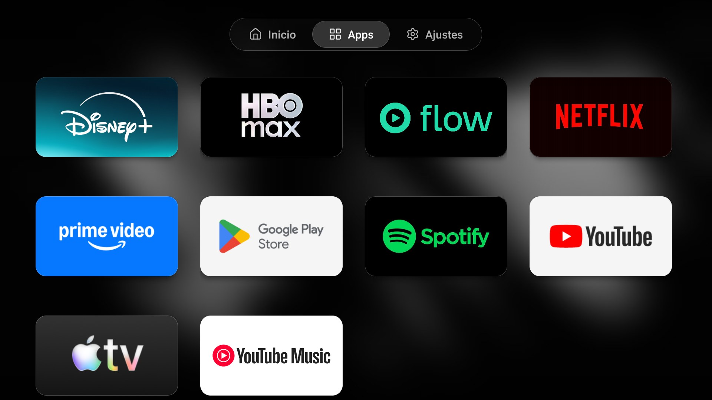
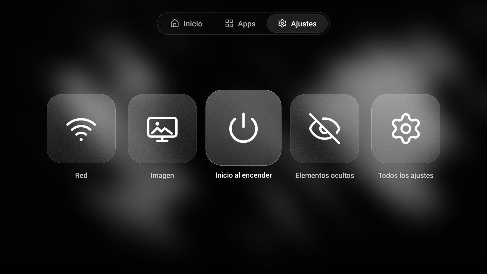
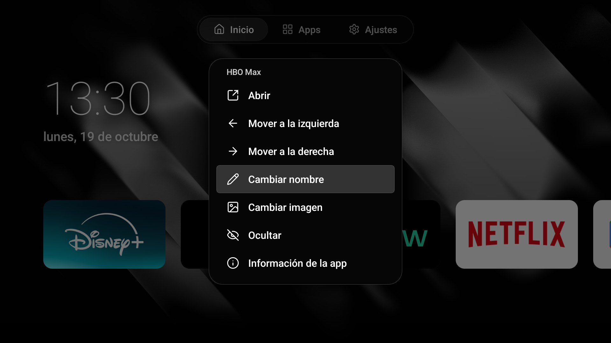

<p align="center">
  
</p>

<h1 align="center">tvOS</h1>

<p align="center">
  <strong>Un launcher de vidrio para tu Android TV.</strong><br>
  Nativo, liviano y totalmente personalizable, con el estilo de Apple TV.
</p>

<p align="center">
  
  
  
  
  
  
</p>

---

Launcher personalizado para **Android TV** con una interfaz de vidrio inspirada en Apple TV: pill de secciones, desenfoque, animaciones suaves y personalización total de cada tile.

Escrito en **Kotlin** con **Views nativas en XML**, sin Compose ni librerías pesadas. El APK de release pesa menos de 1 MB y funciona fluido en hardware modesto (probado en una tele con 2 GB de RAM y CPU de 32 bits).

<p align="center">
  
  
</p>
<p align="center">
  
  
</p>

## Características

**Interfaz**
- Pill de navegación superior con tres secciones: **Inicio**, **Apps** y **Ajustes**. El selector se desliza entre pestañas sin recalcular el layout.
- Fondo con wallpaper nítido en Inicio y una versión desenfocada en las otras secciones, para dar profundidad.
- Material de vidrio solo en controles y navegación (pill y menús): desenfoque del fondo, tinte, borde uniforme de 1 px y sombra suave. Los tiles quedan sólidos.
- Animación de apertura, foco con escala sobre cada tile y transiciones entre secciones con una curva de salida tipo Apple.
- Reloj y fecha en Inicio. Borde de scroll bajo el pill para mantener la legibilidad.

**Contenido**
- **Inicio:** apps pensadas para TV más las entradas HDMI.
- **Apps:** grilla con todas las apps instaladas, incluidas las que no son de TV.
- **Ajustes:** cards de vidrio con grano e iconos propios: Red, Imagen, Inicio al encender, Elementos ocultos y Todos los ajustes.
- **Entradas HDMI:** tiles propios que cambian de entrada con el framework de TV de Android, sin depender de otra app.

**Personalización (mantené OK sobre cualquier tile)**
- Abrir, mover a la izquierda o a la derecha, cambiar nombre, cambiar imagen, ocultar, ver información de la app y desinstalar (solo apps de usuario).
- Los elementos ocultos se restauran desde **Ajustes → Elementos ocultos**.
- Imágenes incluidas para PlayStation, Xbox, HBO Max, Spotify y Netflix. HBO Max, Spotify y Netflix se aplican automáticamente a su app.
- Imágenes propias: cualquier PNG, JPG o WebP que copies a la carpeta de arte aparece en **Cambiar imagen** (ver [Imágenes propias](#imágenes-propias)).

## Stack

| | |
|---|---|
| Lenguajes | **Kotlin** (lógica y UI), **XML** (layouts y recursos), **Kotlin DSL** (Gradle) |
| UI | Views nativas con `RecyclerView`. Sin Compose |
| Dependencias | Solo `androidx.recyclerview` |
| Build | Gradle 8.14, Android Gradle Plugin 8.7, Kotlin 2.0 |
| SDK | `minSdk` 28, `targetSdk` 34, `compileSdk` 35 |

## Requisitos

| | |
|---|---|
| Dispositivo | Android TV con Android 9 (API 28) o superior |
| Probado en | Philips 50PUD7408/77, Android TV 14 |
| Compilar | JDK 17 y Android SDK con plataforma 35 y build-tools 35.0.0 |

## Compilar

```bash
./gradlew assembleRelease
```

El APK queda en `app/build/outputs/apk/release/app-release.apk`. El build de release se firma con la clave de debug, pensada para uso personal.

Crea un `local.properties` con la ruta de tu SDK si Gradle no lo encuentra:

```properties
sdk.dir=/ruta/al/Android/sdk
```

## Instalar en la tele

1. En la tele, abrí **Ajustes → Preferencias del dispositivo → Acerca de** y tocá **Compilación** siete veces para activar el modo desarrollador.
2. En **Opciones de desarrollador**, activá **Depuración inalámbrica** y elegí **Vincular dispositivo con código**.
3. Desde tu computadora, en la misma red:

```bash
adb pair IP:PUERTO_DE_VINCULACION
adb connect IP:PUERTO_DE_CONEXION
adb install -r app/build/outputs/apk/release/app-release.apk
```

4. Abrilo desde la lista de apps de la tele. En **Ajustes → Inicio al encender** podés elegirlo como app de inicio predeterminada.

## Dejarlo como app de inicio

```bash
adb shell cmd role add-role-holder --user 0 android.app.role.HOME dev.tommy.tvlauncher
```

Para volver al launcher original:

```bash
adb shell cmd role add-role-holder --user 0 android.app.role.HOME com.google.android.apps.tv.launcherx
```

### Limitación conocida

En el firmware probado, el botón **Home** y el encendido siguen abriendo el launcher de Google TV aunque este sea la app de inicio predeterminada. Desactivar el launcher de Google TV **no es recomendable**: al apretar Home el sistema cae en una pantalla de recuperación. Si lo desactivaste, revertilo con:

```bash
adb shell pm enable com.google.android.apps.tv.launcherx
```

Los launchers de terceros que reemplazan el botón Home suelen apoyarse en un servicio de accesibilidad. Este proyecto no lo incluye todavía.

## Imágenes propias

Copiá las imágenes a la carpeta de arte de la app. Se recomienda formato 16:9, por ejemplo 640×360.

```bash
adb push mi-logo.png /sdcard/Android/data/dev.tommy.tvlauncher/files/art/
```

Después mantené OK sobre un tile, elegí **Cambiar imagen** y seleccioná el archivo.

## Estructura del proyecto

```
app/src/main/java/dev/tommy/tvlauncher/
├── MainActivity.kt          Secciones, foco, animación de apertura y menú
├── AppRepository.kt         Apps, entradas HDMI, orden, nombres y arte
├── AppAdapter.kt            Tiles y tarjetas de Ajustes
├── GlassFrameLayout.kt      Material de vidrio: fondo desenfocado, tinte y borde
├── GlassTabBar.kt           Pill de secciones con selector deslizante
├── GlassBackdrop.kt         Mapeo del fondo desenfocado a cada superficie
├── TileMenu.kt              Menú contextual y entrada de texto
├── Customization.kt         Preferencias: ocultos, orden, imágenes y nombres
├── ArtRepository.kt         Imágenes incluidas y carpeta de arte del usuario
├── PortRepository.kt        Entradas HDMI desde TvInputManager
├── PortArtFactory.kt        Imagen por defecto de los tiles HDMI
└── Motion.kt                Curva de animación compartida
```

### Decisiones de rendimiento

- El wallpaper desenfocado es un asset precalculado: no hay blur en tiempo de ejecución.
- El selector del pill se anima moviendo sus límites directamente, sin pedir un nuevo layout en cada cuadro.
- Las tres secciones permanecen medidas aunque estén ocultas, para que cambiar de una a otra no dispare un layout pesado.
- La única dependencia es `androidx.recyclerview`.

## Hoja de ruta

- Detección automática de consolas por HDMI-CEC para asignar su logo.
- Selector de wallpaper dentro de la app.
- Servicio de accesibilidad opcional para tomar el botón Home.
- Traducciones.

## Créditos y avisos

- Iconos de navegación y menús: [Lucide](https://lucide.dev), licencia ISC.
- Los logos de PlayStation, Xbox, HBO Max, Spotify y Netflix son marcas registradas de sus respectivos dueños y se incluyen solo para uso personal. Reemplazalos si publicás un fork.
- Proyecto personal e independiente. No está afiliado ni respaldado por Apple, Google, Philips ni ninguna de las marcas mencionadas. El diseño toma como referencia las [pautas de Liquid Glass](https://developer.apple.com/documentation/technologyoverviews/liquid-glass) de Apple.

## Licencia

Sin definir todavía. Hasta que se agregue un archivo `LICENSE`, todos los derechos quedan reservados.
